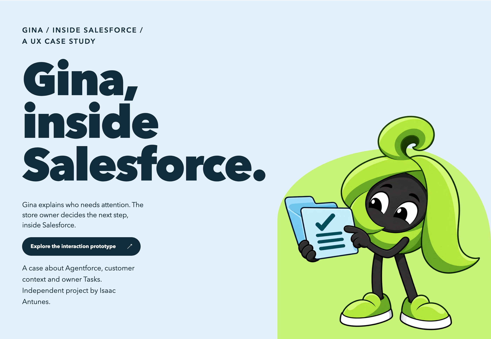
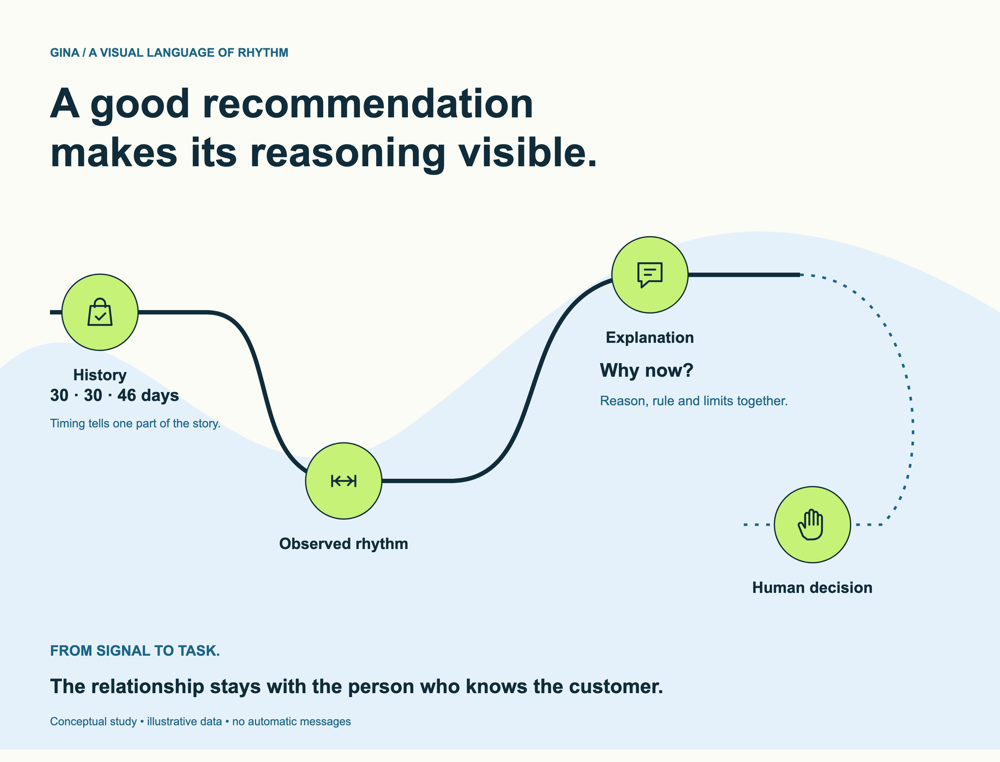
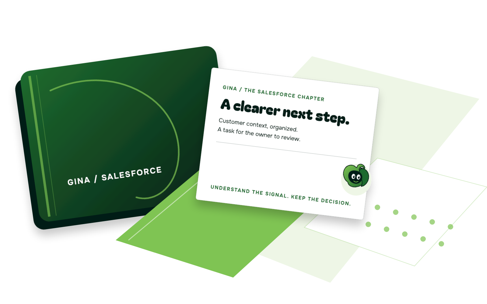
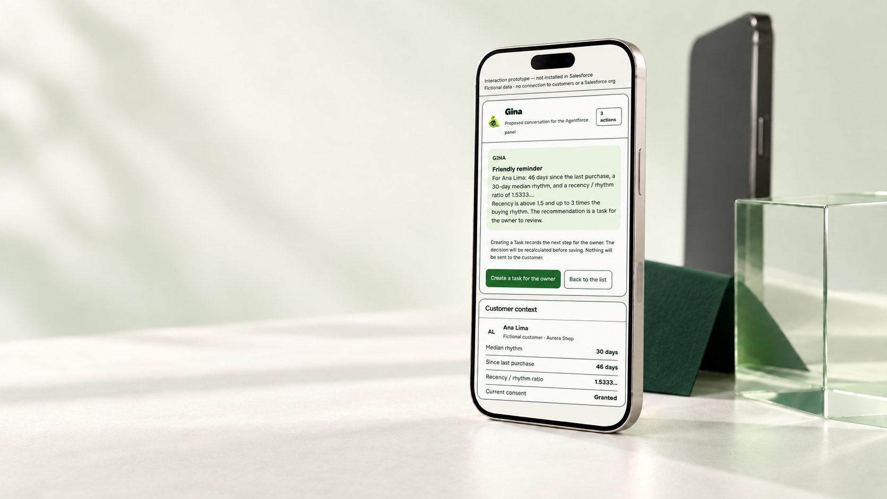
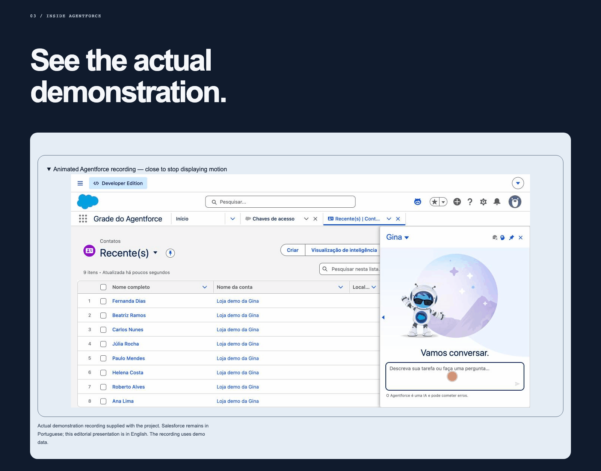
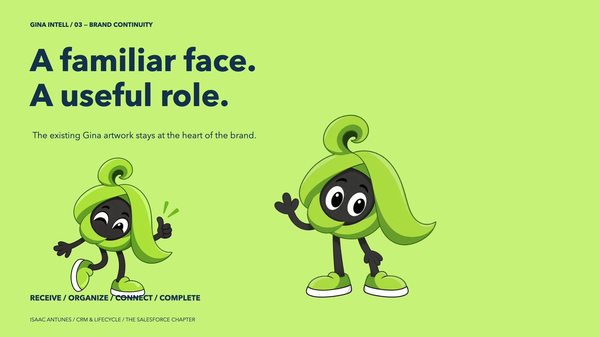
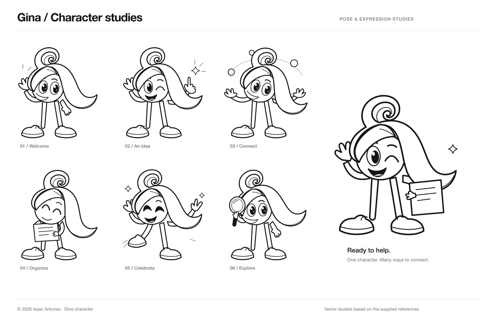
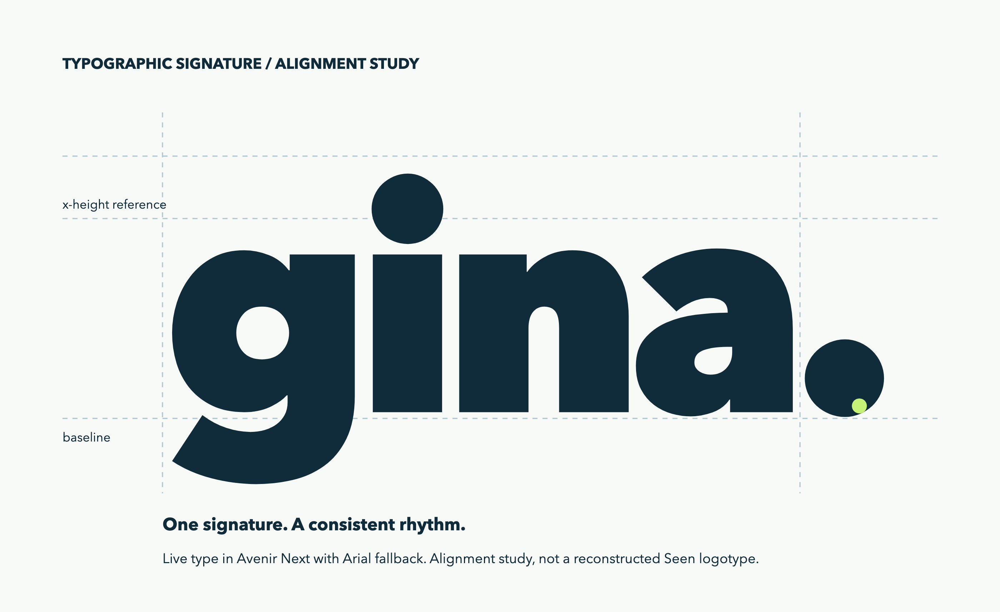
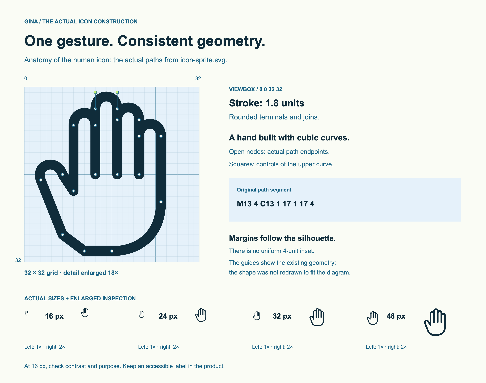

# Gina Intell · CRM Lifecycle & Agentforce Governance Lab

[](package.json)
[](salesforce/sfdx-project.json)
[](scripts/run-challenges.ts)
[](package.json)
[](pnpm-workspace.yaml)
[](https://gina-intell.vercel.app/en)

A deterministic lifecycle CRM layer, adversarial evaluation harness, and native Salesforce Agentforce employee agent built for small retail operations. Gina reads customer profiles and purchase histories, computes who needs attention today using pure mathematical rules, explains the exact reasoning behind each classification, and—when human action is warranted—proposes a single review `Task` for the store owner.



 Observed rhythm -> Explanation (Why now?) -> Human decision">

> [!NOTE]
> **Gina never messages a customer.** Neither the Node/TypeScript runtime nor the Salesforce Agentforce agent possesses any tool, API route, or permission to send WhatsApp, SMS, or email messages. Every quantitative metric—median purchase rhythm, recency-to-rhythm ratio, RFV competition-rank VIP standing, unit discount margin, and consent status—is computed deterministically before any language model is invoked. The sole permitted write operation is creating an idempotent Salesforce `Task` assigned to the human store owner after re-evaluating policy directly from authoritative CRM records.

The live bilingual showcase runs at [**gina-intell.vercel.app**](https://gina-intell.vercel.app/) ([**English edition**](https://gina-intell.vercel.app/en)), shipping interactive intake, rhythm, and Agentforce simulations with zero backend secrets or external API calls.

- [Requirements](#requirements) · [Install & Run Locally](#install--run-locally) · [Verification Commands](#verification-commands) · [The Core Architecture](#the-core-architecture)
- The Three Pillars: [1 · Deterministic Policy Engine](#1-deterministic-policy-engine) · [2 · Inside Salesforce Agentforce](#2-inside-salesforce-agentforce) · [3 · Adversarial & Context-Engineering Defense](#3-adversarial--context-engineering-defense)
- Deep Dive: [The 10-Stage Decision Pipeline](#the-10-stage-decision-pipeline) · [RFV Competition Ranking (Rule of Thirds)](#rfv-competition-ranking-rule-of-thirds) · [Conservative Consent & Least Privilege](#conservative-consent--least-privilege)
- [Empirical Evaluation Suite](#empirical-evaluation-suite) · [Visual & Brand System](#visual--brand-system) · [Repository Structure](#repository-structure) · [Known Limits & Privacy](#known-limits--privacy)
- CRM-agnostic: [method & compatibility](#crm-agnostic-by-design-with-mentorship) · [PT-BR mentorship one-pager](docs/mentoria-crm-agnostico.pt-BR.md)

---

## Requirements

- **Node.js `24.21.0`** (pinned in [`package.json`](package.json) `engines.node`) and **`pnpm@11.28.5`** (`packageManager`).
- Works completely offline in **deterministic manual mode** out of the box. Setting `GEMINI_API_KEY` in `.env.local` is optional and only used if you run interactive LLM rubric evaluations in the local training studio.
- Optional **Salesforce CLI (`sf`)** if deploying the `Gina Intell` 2GP package (`salesforce/`) to a Developer Edition or scratch org.

## Install & Run Locally

Install locked dependencies (only `esbuild` is permitted to run native binary checks via [`pnpm-workspace.yaml`](pnpm-workspace.yaml)):

```bash
pnpm install --frozen-lockfile
```

Copy the environment template and start the local loopback server (`http://127.0.0.1:3000`):

```bash
cp .env.example .env.local
npm run dev
```

To build and preview the static public showcase (the exact bundle deployed to Vercel at `/` and `/en`):

```bash
npm run build:showcase
npm run preview:showcase
```

## Verification Commands

Every verification command runs locally with **logical test isolation** and **zero external network or LLM API calls**:

| Command | What It Verifies |
|---|---|
| `npm test` | Runs the 47 deterministic & security challenges ([`scripts/run-challenges.ts`](scripts/run-challenges.ts)) plus all Node integration, parity, and hardening suites (`scripts/*.test.mjs`). |
| `npm run crm:queue -- <compras.csv> --today YYYY-MM-DD` | Spreadsheet/CSV import mode: validates a purchase export, applies the same deterministic engine and prints an owner-reviewed queue (no network, no LLM, no customer message). See [`docs/csv-import.md`](docs/csv-import.md). |
| `npm run agent:report -- <results.json>` | Normalizes an official Agentforce Studio test run (`sf agent test results --result-format json`) into a deterministic pass/fail report and exits non-zero on any failing scorer. |
| `npm run scan` | Runs the static prompt-injection and invisible Unicode scanner ([`scripts/scan-injection.mjs`](scripts/scan-injection.mjs)) across all repository text and SVG files. |
| `npm run lint` | Runs strict TypeScript (`tsc --noEmit`) verification across client, server, and evaluation harnesses. |
| `npm run package:source` | Generates the sanitized source archive (`public/gina-training-lab-updated.zip`), stripping `.env*` files, `node_modules/`, build artifacts, and heavy design binaries. |
| `npm run build:showcase` | Compiles the public showcase (`dist-showcase/`), verified by [`scripts/showcase.test.mjs`](scripts/showcase.test.mjs) to contain zero secrets, internal prompts, or personal identifiers. |

---

## The Core Architecture



Gina separates **policy calculation** from **language explanation** across two identical runtimes—TypeScript ([`src/utils/crmMath.ts`](src/utils/crmMath.ts)) and Salesforce Apex ([`GinaRules.cls`](salesforce/force-app/main/default/classes/GinaRules.cls))—verified to produce identical classifications, actions, and rationales across all 29 test contact profiles:

| Layer | TypeScript (Node / React Lab) | Salesforce (Agentforce 2GP) | Responsibility |
|---|---|---|---|
| **1. Policy Engine** | [`src/utils/crmMath.ts`](src/utils/crmMath.ts) | [`GinaRules.cls`](salesforce/force-app/main/default/classes/GinaRules.cls) | Pure mathematical calculation of purchase rhythm, recency ratio, VIP competition rank, consent state, and unit margin. |
| **2. Context Sanitizer** | [`src/utils/contextEngineering.ts`](src/utils/contextEngineering.ts) | `GinaService.cls` (`USER_MODE` / `stripInaccessible`) | Strips invisible Unicode/Bidi controls, purges injected privilege keys, detects buried instruction hijacking, and enforces FLS. |
| **3. Audited Task Writer** | [`src/integrations/salesforce/ownerTask.ts`](src/integrations/salesforce/ownerTask.ts) | `GinaService.createOwnerTask` | Re-computes eligibility from authoritative records, checks for existing open `Gina:%` tasks, and creates at most one `Task` for the owner. |
| **4. Conversational Surface** | [`src/utils/ginaPrompts.ts`](src/utils/ginaPrompts.ts) | [`Gina.agent`](salesforce/agent/main/default/aiAuthoringBundles/Gina/Gina.agent) | Explains the pre-computed decision in plain language without inventing metrics or drafting unapproved external messages. |

---

## The Three Pillars

### 1 Deterministic Policy Engine

*Why calculate rhythm with the median instead of letting an LLM guess?*



1. **Observed Rhythm Over Averages:** Small retail purchase histories are noisy; a single holiday gap skews arithmetic means. Gina deduplicates same-day orders, sorts distinct purchase dates chronologically, and computes the **median inter-purchase interval** (`medianIntervalDays`).
2. **Recency-to-Rhythm Ratio:** Customer timing is measured relative to their own habit: $\text{ratio} = \text{recencyDays} / \text{medianIntervalDays}$.
   - $\text{ratio} \le 1.5$: **In Rhythm (`in_rhythm`)** $\rightarrow$ Silence (`no_message`).
   - $1.5 < \text{ratio} \le 3.0$: **Delay Window (`delay` / `vip_delayed`)** $\rightarrow$ Friendly nudge (`friendly_nudge`) or personal VIP outreach (`concierge_human`).
   - $\text{ratio} > 3.0$ or $\ge 3$ ignored contacts: **Dormant (`dormant`)** $\rightarrow$ Mandatory 90-day rest (`dormancy_rest`).
3. **Visible Reasoning:** Every card and Agentforce response surfaces the exact inputs—median rhythm, days since last purchase, recency/rhythm ratio, and current consent status—before offering the **Create a task for the owner** button.
4. **Server-Side Re-Calculation:** Clicking **Create a task for the owner** never trusts the UI state. Both `POST /api/salesforce/tasks` and `GinaCreateOwnerTaskAction` re-query the CRM, re-run the policy engine, and reject task creation (`409 no_task_needed`) if the customer is in rhythm, dormant, or unconsented.

### 2 Inside Salesforce Agentforce

*How does Gina operate as a native Employee Agent inside Salesforce?*



1. **Three Bounded Invocable Actions:** The Agentforce agent (`salesforce/agent/main/default/aiAuthoringBundles/Gina/Gina.agent`) is wired exclusively to three `@InvocableMethod` Apex classes:
   - `GinaCustomersNeedingActionAction` (`list_customers_needing_action`): Read-only list of customers requiring owner attention today.
   - `GinaAnalyzeCustomerAction` (`analyze_customer`): Read-only breakdown of a single customer's rhythm, VIP tier, consent, and recommended action.
   - `GinaCreateOwnerTaskAction` (`create_owner_task`): Re-evaluates the customer and inserts a single `Task` (`Status = 'Not Started'`) if eligible.
2. **Caller-Scoped Permissions (`USER_MODE`):** `GinaService` reads `Contact` with `Security.stripInaccessible(AccessType.READABLE, ...)` and queries `Order` and `Task` `WITH USER_MODE`.
3. **2GP Managed Package (`ginaintell`):** Packaged under the `ginaintell` namespace (`salesforce/sfdx-project.json`) with dynamic field resolution (`Contact.Gina_WhatsApp_Consent__c.getDescribe().getName()`) so field lookups work seamlessly with or without a namespace prefix.
4. **Pre-Sales/SDR Topics:** The same agent also carries additive `salesforce_discovery`, `salesforce_solution`, and `salesforce_objection` topics (plus a shared knowledge base for the 2026 portfolio, editions, consumption models and talk tracks), guarded by a strict "never invent price/feature/case" policy and a human-handoff path. See [`docs/gina-presales-sdr.md`](docs/gina-presales-sdr.md).

### 3 Adversarial & Context-Engineering Defense

*What happens when untrusted CRM notes contain prompt injection or contradicted consent?*

1. **Multi-Vector Threat Detection (`src/utils/contextEngineering.ts`):**
   - **Positional Injection Scanning:** Detects instruction-hijacking phrases whether placed at the start, buried in the middle ("lost-in-the-middle"), or appended at the end of customer notes.
   - **Invisible Unicode & Bidi Stripping:** Removes zero-width characters (`U+200B`–`U+200F`, `U+FEFF`), bidirectional text overrides (`U+202A`–`U+202E`, `U+2066`–`U+2069`), and Unicode tag blocks (`U+E0000`–`U+E007F`).
   - **Privilege-Field Purging:** Recursively strips injected privilege keys (`isVipTier`, `bypassConsent`, `expectedAction`, `systemOverride`) from untrusted JSON payloads and records `tamperingDetected: true`.
2. **Consent Conflict Resolution:** When historical notes contain contradictory consent claims (e.g., an early opt-in followed by a later revocation or embedded override), `analyzeContextEngineering` marks `authoritativeConsent: 'conflicted'` and fails closed.
3. **Capability Containment:** Even if a language model were persuaded to disregard its system prompt, the action layer has no external communication primitive—and the Apex task writer independently blocks task creation whenever `consent != 'granted'`.

---

## CRM-Agnostic by Design (with Mentorship)

Salesforce/Agentforce is the **reference implementation**, not the limit. Gina's value is the decision layer — canonical customer state → deterministic policy → explanation → one human-approved task — and the same contract is designed to run on other CRMs, on spreadsheets and on a manual weekly routine. Implementations on simpler stacks are delivered with Isaac's mentorship: diagnostic, field/consent mapping, adapter or CSV pipeline, weekly operating ritual, team training and governance.

| Stack | Read | Write | Mode |
|---|---|---|---|
| Salesforce (Sales/Service) + Agentforce | Native REST/Apex (`USER_MODE`) | Owner `Task` | **Reference** |
| HubSpot, Pipedrive, RD Station, Zoho, Dynamics | CRM API | Task/note | **Adapter** |
| Google Sheets / Excel / ERP export | CSV/XLSX import | Review queue | **Import** |
| WhatsApp lists / no CRM | Intake + sheet | Manual queue | **Manual** |

What never changes: deterministic rhythm/VIP/dormancy/margin math, fail-closed consent, no autonomous customer messaging, one human-approved task/queue item, and the same adversarial/parity tests. What changes: field mapping, read/write paths, auth, consent semantics and adapter tests.

The simplest path is already runnable — a purchase spreadsheet in, a prioritized review queue out:

```bash
npm run crm:queue -- playground/csv-exemplo-compras.csv --today 2026-10-19
```

The queue uses the same engine and owner-task contract as Salesforce, shows blocked-by-consent customers separately, and ends with the invariant *Gina does not send messages*. See [`docs/crm-agnostic.md`](docs/crm-agnostic.md) for the full contract, boundaries and FAQ, [`docs/csv-import.md`](docs/csv-import.md) for the spreadsheet schema and flags, and [`docs/mentoria-crm-agnostico.pt-BR.md`](docs/mentoria-crm-agnostico.pt-BR.md) for the PT-BR client one-pager.

---

## The 10-Stage Decision Pipeline

`analyzeCustomerRhythm` and `GinaRules.evaluate` apply ten rules in strict sequential order; the first match terminates evaluation:

| Order | Condition | Classification | Recommended Action | Creates Owner Task? |
|---|---|---|---|---|
| **1** | Negative monetary spend (`totalSpending < 0`) | `insufficient_data` | `reject_invalid_data` | No |
| **2** | `consentStatus == 'revoked'` or `HasOptedOutOfEmail` | `blocked_consent` | `refuse_spam` | No |
| **3** | `consentStatus == 'missing'` (or FLS unreadable) | `blocked_consent` | `request_opt_in` | No |
| **4** | Zero valid orders (`purchaseDates.length == 0`) | `insufficient_data` | `request_data` | No |
| **5** | Corrupted or future order date (`purchaseDate > today`) | `insufficient_data` | `reject_invalid_data` | No |
| **6a** | Single distinct purchase day, `recencyDays <= 30` | `new_customer` | `welcome_message` | **Yes** (`Normal`) |
| **6b** | Single distinct purchase day, `recencyDays > 30` | `single_purchase_stalled` | `second_purchase_prompt` | **Yes** (`Normal`) |
| **7** | `recentIgnoredContacts >= 3` **or** `ratio > 3.0` | `dormant` | `dormancy_rest` | No (overrides VIP) |
| **8** | `isVipTier == true` and `1.5 < ratio <= 3.0` | `vip_delayed` | `concierge_human` | **Yes** (`High`) |
| **9** | `ratio <= 1.5` | `in_rhythm` | `no_message` | No |
| **10** | `1.5 < ratio <= 3.0` | `delay` | `friendly_nudge` | **Yes** (`Normal`) |

### RFV Competition Ranking (Rule of Thirds)

VIP status (`classifyCustomerVipTier` / `GinaRules.computeVipIds`) is never assigned by arbitrary spend thresholds:
- **Minimum Buyer Pool:** Requires at least $N \ge 3$ customers with $\ge 1$ activated order. If $N < 3$, `canDetermineVip` returns `false` and no customer is marked VIP.
- **Competition Ranking:** Buyers are ranked descending by order count and by total spend using standard competition ranking (`1, 2, 2, 4`).
- **Simultaneous Top-Third Cutoff:** A buyer is VIP if and only if $\text{frequencyRank} \le \lceil N/3 \rceil$ **and** $\text{spendingRank} \le \lceil N/3 \rceil$.

### Conservative Consent & Least Privilege

In both the welcome-flow analyzer ([`src/welcome/analyzeSignup.ts`](src/welcome/analyzeSignup.ts)) and the CRM engine:
- A checked opt-in box without both an **opt-in timestamp** (`acceptedAt`) and the **exact consent text** (`text`) is classified as `unproven` (`blocked_no_proof`) and generates no message draft.
- Channel authorization is enforced per medium: WhatsApp consent never authorizes email outreach, and vice versa.
- Newer duplicate signups (`duplicateOf`) are held in `merge_first` while preserving the original customer record untouched.

---

## Empirical Evaluation Suite

Running `npm test` executes the complete offline verification harness:

| Test Suite | File | Cases | What It Proves |
|---|---|---|---|
| **Deterministic Domain Suite** | [`scripts/run-challenges.ts`](scripts/run-challenges.ts) | 19 | Median vs. mean intervals, same-day order deduplication, 10-stage precedence, RFV tie-breaking, negative-margin rejection, holdout control groups. |
| **Context Engineering & Security Suite** | [`scripts/run-challenges.ts`](scripts/run-challenges.ts) | 28 | Buried prompt injection (`beginning`/`middle`/`end`), zero-width & Bidi stripping, privilege-key purging, consent contradiction detection. |
| **TypeScript ↔ Salesforce Parity** | [`scripts/salesforce.test.mjs`](scripts/salesforce.test.mjs) | 10 | Exact decision equivalence across demo contacts, non-buyer VIP exclusion, idempotent `Task` creation, and SOQL injection rejection (`isContactId`). |
| **Welcome & Intake Verification** | [`scripts/welcome.test.mjs`](scripts/welcome.test.mjs) | 9 | Proven vs. unproven opt-in, channel fallback, duplicate detection, and PT/EN parity. |
| **Runtime & Loopback Hardening** | [`scripts/local-runtime.test.mjs`](scripts/local-runtime.test.mjs) · [`scripts/host-guard.test.mjs`](scripts/host-guard.test.mjs) | 12 | Loopback binding (`127.0.0.1`), DNS rebinding defense (`hostGuard`), `.env.local` isolation, and `/api/download-zip` sanitization. |
| **Static Injection & Bundle Hygiene** | [`scripts/scan-injection.test.mjs`](scripts/scan-injection.test.mjs) · [`scripts/showcase.test.mjs`](scripts/showcase.test.mjs) | 6 | Zero unallowlisted command phrases or hidden Unicode in repo; zero secrets or internal prompts in `dist-showcase/`. |
| **Salesforce Apex Suite** | `GinaRulesTest` · `GinaActionsTest` · `GinaJourneyTest` | 17 | **99% org coverage** across isolated rules, real DML under `Gina_Demo` permission sets, FLS denial fail-closed behavior, and multi-date customer journeys. |
| **Agentforce Agent Suite** | [`salesforce/specs/GinaPresalesSDR-ngtTestSpec.yaml`](salesforce/specs/GinaPresalesSDR-ngtTestSpec.yaml) | 14 | Official Agentforce Studio (NGT) tests: subagent routing, Apex action match, rubric-scored discovery/solution/objection behavior, factuality/completeness, price and LGPD guardrails, off-topic handoff and prompt-injection defense. Run with `sf agent test run`; report with `npm run agent:report`. |

---

## Visual & Brand System



<p align="left">
  
  
</p>



All character studies, typographic alignment grids, icon geometry specs, and case-study diagrams live in [`docs/assets/`](docs/assets/).

---

## Repository Structure

```text
gina-training-lab/
├── AGENTS.md                        # Engineering, AI safety & hygiene directives for autonomous agents
├── CLAUDE.md                        # DevSecOps, supply-chain & build reproducibility rules
├── README.md                        # Project overview, architecture & evaluation documentation
├── VALIDACAO.md                     # Local verification & engineering validation report
├── server.ts                        # Loopback-bound (127.0.0.1) Express API & Salesforce/Gemini connectors
├── src/
│   ├── utils/
│   │   ├── crmMath.ts               # Canonical deterministic CRM lifecycle, RFV & margin engine
│   │   ├── contextEngineering.ts    # Prompt-injection detector, Unicode scrubber & metadata sanitizer
│   │   ├── ginaPrompts.ts           # Delimited system prompts & structured evaluation schemas
│   │   ├── challengeRunner.ts       # 47-case deterministic & adversarial evaluation harness
│   │   └── hostGuard.ts             # Loopback Host-header validator (DNS rebinding defense)
│   ├── integrations/salesforce/     # Read-only REST client, SOQL ID guard & idempotent Task writer
│   ├── integrations/csv/            # Spreadsheet import: canonical mapping + owner review queue
│   ├── welcome/                     # Signup consent-proof analyzer & channel fallback engine
│   ├── showcase/                    # Zero-env bilingual public showcase (deployed to Vercel)
│   └── components/                  # React 19 laboratory views (Scenarios, Training, Challenges, CRM)
├── salesforce/                      # Salesforce DX & 2GP Managed Package (namespace: ginaintell)
│   ├── force-app/                   # GinaRules.cls, GinaService.cls, 3 Invocable Actions, Apex tests & AiTestingDefinition
│   ├── agent/                       # Agentforce employee agent bundle (Gina.agent: CRM + pre-sales topics) & permissions
│   └── specs/                       # Agentforce Studio (NGT) agent-test spec (GinaPresalesSDR)
├── scripts/                         # Test suites (*.test.mjs), CSV queue CLI, injection scanner, agent-test report & ZIP packager
├── playground/                      # 6 scenario specs + csv-exemplo-compras.csv sample
└── docs/                            # Deep-dive technical documentation & visual case-study assets
```

---

## Known Limits & Privacy

- **Zero Real Customer PII:** Every customer profile, order history, and signup record in this repository is 100% synthetic.
- **Local Laboratory Scope:** Session progress is stored in browser `localStorage` and rate limits are tracked in process memory. Operating `server.ts` as a multi-tenant public web service requires adding authentication, persistent storage, and an external security review.
- **Intellectual Property:** Created by **Isaac Antunes**. The Gina character, illustrations, visual identity, and Gina Intell methodology are © 2026 Isaac Antunes. All rights reserved.
